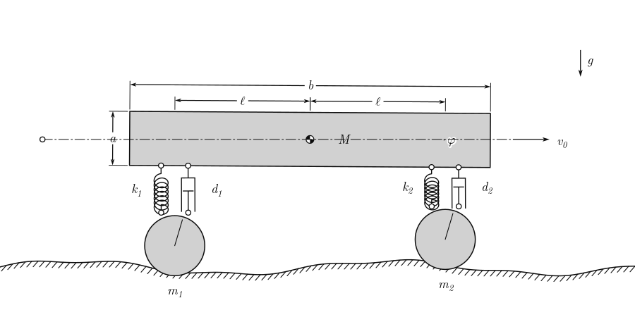
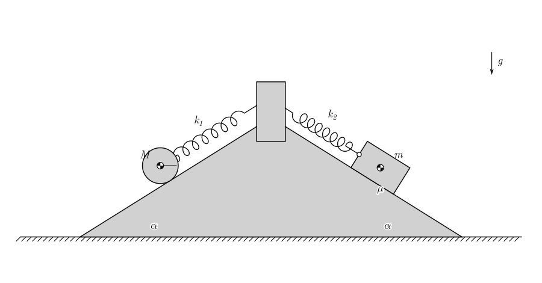
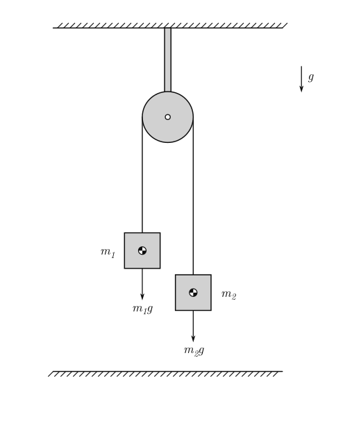
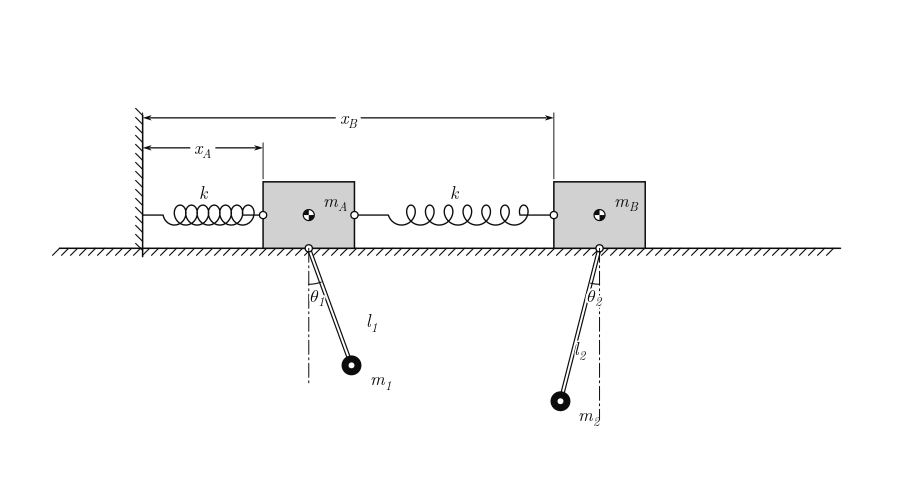
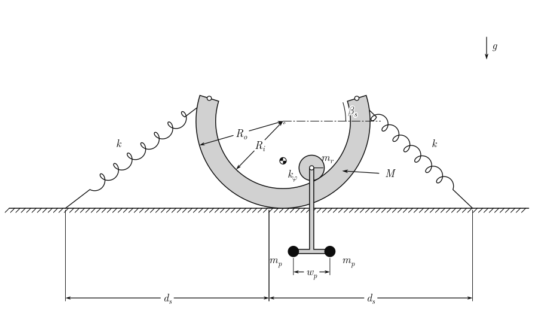
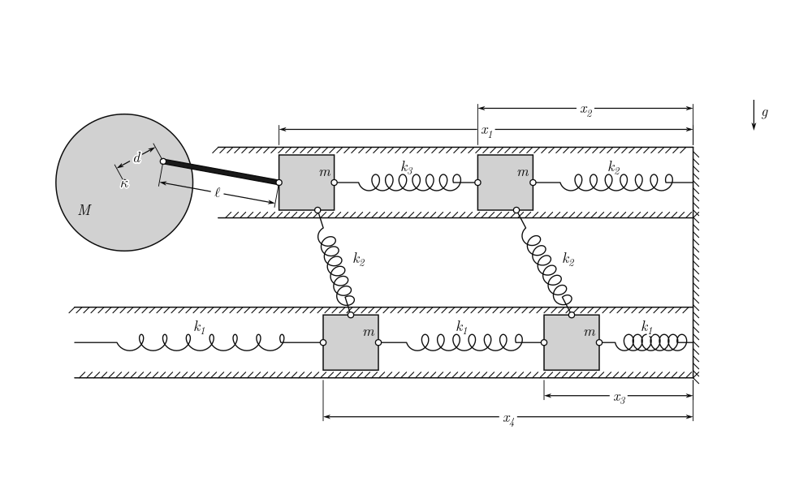
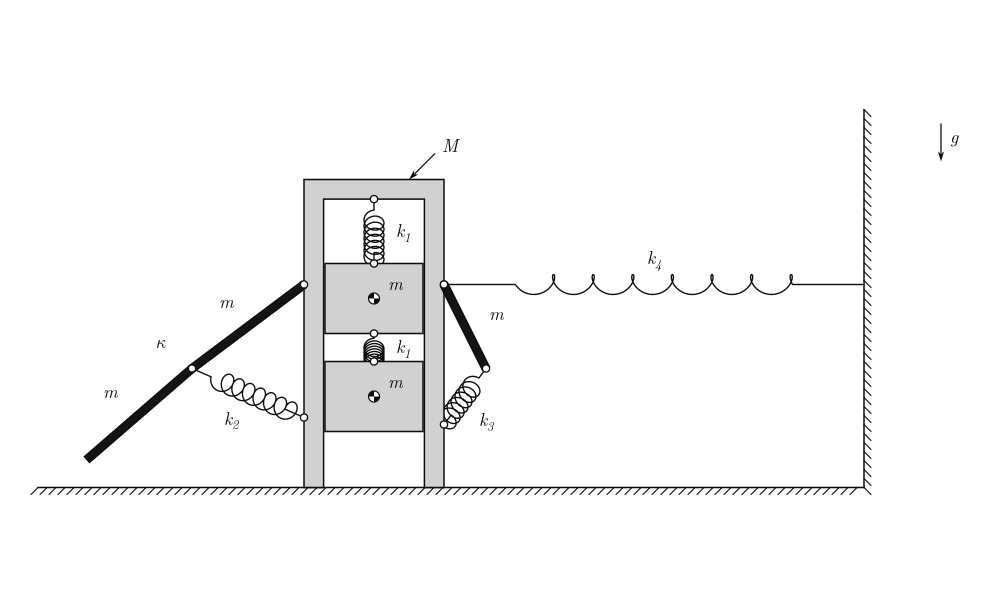
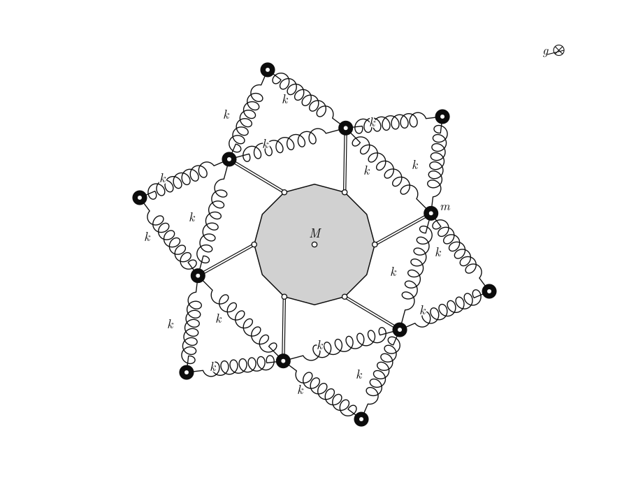
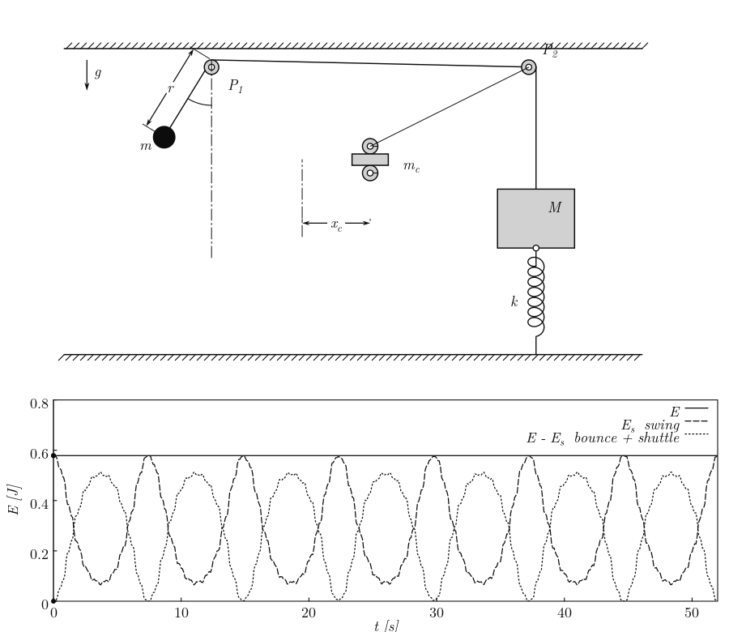
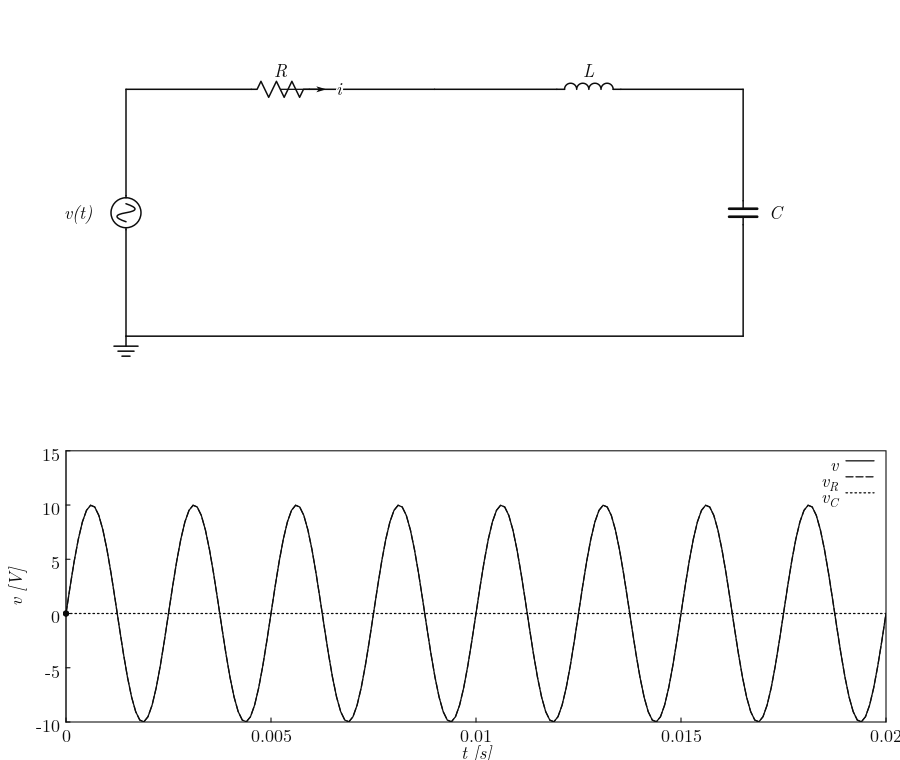

# Physics Illustration library in C (pil-c)

A small C99 library that simulates 2D mechanical systems and draws them the way
a textbook does: grey bodies, coil springs, dashpots, hatched ground, hinges,
dimension lines, italic serif labels with `x_1`-style subscripts and Greek
letters. You describe a problem by dropping elements into a world; the library
solves the dynamics and renders it to PNG / PDF / SVG, to a GIF/MP4, or to an
interactive window.

<table>
  <tr>
    <td align="center"><br><b>Half-Car on Wavy Road</b></td>
    <td align="center"><br><b>Cylinder & Block on Wedge</b></td>
  </tr>
  <tr>
    <td align="center"><br><b>Atwood Machine</b></td>
    <td align="center"><br><b>Two blocks with pendulums</b></td>
  </tr>
  <tr>
    <td align="center"><br><b>Circle-in-Circle Rolling</b></td>
    <td align="center"><br><b>Disc driving a crank and rod into of coupled sliding masses</b></td>
  </tr>
  <tr>
    <td align="center"><br><b>Sliding frame with two sprung blocks, a two-link arm with a torsion knee, a sprung link and k4 spring to the wall</b></td>
    <td align="center"><br><b>Two blocks with pendulums</b></td>
  </tr>
  <!-- <tr> -->
  <!--   <td align="center"><br><b>     </b></td> -->
  <!--   <td align="center"><br><b>   </b></td> -->
  <!-- </tr> -->
  <!-- <tr> -->
  <!--   <td align="center"><br><b>     </b></td> -->
  <!--   <td align="center"><br><b>   </b></td> -->
  <!-- </tr> -->
</table>

## Features

- **Rigid Body Dynamics:** Full 2D translation and rotation with impulse-based constraints.
- **Textbook Renderer:** Cairo-powered backend that draws perfect hatching, zig-zag springs, dashpots, and LaTeX-style labels.
- **Drop-in Elements:** Springs, dampers, pulleys, ropes, slots, and terrain contacts.
- **Interactive:** Built-in SDL2 window for live simulation (grab bodies with your mouse, pause, step, and change gravity).
- **Export:** Output directly to `.png`, `.svg`, or record `.gif`/`.mp4` animations via `ffmpeg`.

## Build

```sh
sudo apt install build-essential pkg-config libcairo2-dev   # required
sudo apt install libsdl2-dev ffmpeg                         # optional: window, gif/mp4
make            # library + examples + tests   (SDL2 is detected automatically)
make test       # numerical regression tests against analytic solutions
sudo make install        # headers, libpil.a, pil.pc
```

Use it from your own program with `cc prog.c $(pkg-config --cflags --libs pil)`.
Text uses _Latin Modern_ (Roman + Math) if installed, as it is with $\TeX$ Live.

## Try it

```sh
./build/halfcar   half.png            # render the first frame
./build/halfcar   --record half.gif 5 # simulate 5 s into a gif (mp4/webm also work)
./build/halfcar   --live              # interactive window

# other examples
./build/atwood
./build/blocks
./build/bowl
./build/crank
./build/frame
./build/incline
./build/ring
./build/pulleys
./build/swing
./build/rectfier
./build/rlc
```

Window keys: `space` pause · `r` reset · `→` step · `+`/`-` speed · `p`/`f`/`g` save
PNG/PDF/SVG · `h` HUD · `esc`. Mouse: left-drag pulls a body, wheel zooms,
right-drag pans.

## A complete program

```c
#include <pil/pil_core.h>
#include <pil/pil_draw.h>

int main(void)
{
    pil_world *w = pil_world_new();                       // gravity defaults to (0,-9.81)

    pil_add_ground(w, (pil_vec2){-1, 0}, (pil_vec2){1, 0});
    pil_add_ground(w, (pil_vec2){1, 1.8}, (pil_vec2){-1, 1.8});    // ceiling: hatching on the other side
    pil_body *m = pil_add_body(w, &(pil_body_desc){
        .shape = pil_rect(0.4, 0.25), .mass = 2.0, .pos = {0, 0.9}, .label = "m" });
    pil_add_prismatic(w, pil_on(m, 0, 0), pil_at(0, 0), (pil_vec2){0, 1});   // vertical guide

    pil_element *k = pil_add_spring(w, pil_at(0, 1.8), pil_on(m, 0, 0.125), 150, 0.6);
    pil_element_set_label(k, "k");
    pil_add_damper(w, pil_at(0.1, 1.8), pil_on(m, 0.1, 0.125), 3.0);

    pil_world_settle(w, 5.0);                             // optional: start at equilibrium
    pil_view v;
    pil_view_fit(&v, -1, -0.1, 1, 2, 600, 600, 20);
    pil_style st = pil_style_textbook();
    pil_record(w, &v, &st, "out.gif", 4.0, 30.0, 5e-4);   // or pil_export_png/pdf/svg, or pil_app_run
    pil_world_free(w);
}
```

## Concepts

- **Bodies** have a shape (`pil_rect`, `pil_disc`, `pil_point_mass`, `pil_poly`,
  `pil_arc_band`), mass, inertia (computed from the shape if you give 0), a state,
  and flags (`PIL_STATIC`, `PIL_SPOKE`, `PIL_HIDDEN`, ...). `pos` is the centre of mass.
  For polygons and arc bands the shape is re-centred on its centroid automatically.
- **Anchors** say _where_ an element attaches: `pil_on(body, lx, ly)` is a point fixed
  in a body, `pil_at(x, y)` is a point fixed in the world. Every element takes anchors.
- **Elements** are what you drop in. Force elements add forces; constraints remove
  degrees of freedom.

| you want                             | call                                                        |
| ------------------------------------ | ----------------------------------------------------------- |
| spring / damper                      | `pil_add_spring`, `pil_add_damper`                          |
| torsional spring (+damper)           | `pil_add_torsion_spring`                                    |
| constant force / "pull"              | `pil_add_force`                                             |
| any force law you like               | `pil_add_custom_force(fn)` - call `pil_apply_force` inside  |
| pin / hinge                          | `pil_add_revolute`                                          |
| rigid rod / rope                     | `pil_add_distance(..., 0)` / `(..., PIL_ROPE)`              |
| rope over a pulley                   | `pil_add_pulley_rope` (+ a static disc body for the pulley) |
| sliding guide, rail                  | `pil_add_slot`, `pil_add_prismatic` (slot + fixed angle)    |
| lock an angle / motor                | `pil_add_fixed_angle`, `pil_add_rotation_drive`             |
| roll without slipping on a line      | `pil_add_rolling` (discs, cylinders, arc bands)             |
| block/wedge/floor contact + friction | `pil_add_floor_contact` (line may belong to a moving body)  |
| uneven moving road                   | `pil_add_terrain` + `pil_add_terrain_contact`               |

- **Annotations** (visual only): `pil_add_dimension`, `_label`, `_arrow`, `_line`,
  `_angle_marker`, `_ground`, `_gravity_indicator`. For anything else register an overlay
  with `pil_world_add_overlay` and draw with Cairo plus the public symbol primitives
  (`pil_draw_spring`, `pil_draw_dashpot`, `pil_draw_hinge`, `pil_draw_arrow`, `pil_draw_text`, ...).
- **Text** understands `x_1`, `x_{12}`, `x^2` and UTF‑8 (`"\xcf\x86"` $\rightarrow$ φ).

## How it works

Each body carries its own coordinates $(x, y, \theta)$ and every joint is an equation
$\phi(q, t) = 0$. With $J = \partial \phi/\partial q$, the motion is $M a + J^{T} \lambda = F$, $J a = \gamma$.
Eliminating $a$ leaves a small dense system for the multipliers $\lambda$. $\gamma$ includes the
velocity-dependent terms and Baumgarte stabilisation, and the state is advanced
with RK4. A new constraint therefore only has to supply $\phi$, $J$ and $\gamma$ - no equations of motion are derived per problem. Ropes add a one-line active set (tension $\lambda \ge 0$, otherwise the rope is slack).

## Tests

`make test` checks the engine against closed-form results: spring period, physical
pendulum period, rolling at `g sin α / 1.5`, Atwood acceleration and tension (to
machine precision), Coulomb deceleration, frictionless slide, double-pendulum energy
drift (< 5·10⁻⁴ of mg·L over 10 s), rope slack/taut, and mouse picking.

## Adding your own element

For a one-off, `pil_add_custom_force` needs no changes to the library. For a reusable
element: add a kind to `pil_el_kind` (`src/pil_internal.h`), a creator in `elements.c`,
a case in `pil_element_apply` (force) or `pil_constraint_eval` (fill `phi`, `vel`, `ja`,
`jb`, and `gamma` from the derivation `Φ̈ = J a − γ₀`), a case in `draw_element`, and a
test in `tests/test_core.c`. `EL_PULLEY` is a compact worked example of each step.

# TODO

- [ ] Make controller `w/a/s/d` to control actuator
- [ ] Electrodynamics and circuits
- [ ] Spinning 3D bodies (require quaternions and a 3D renderer)
- [ ] Rolling is implemented on straight lines. A ball rolling inside a curved body, or two curved bodies rolling on each other, is not yet available.
- [ ] No body–body collision. Contact exists between a body and a line (`pil_add_floor_contact`).
- [ ] Contacts are penalty springs: use `max_dt ≲ 5·10⁻⁴` with stiff contacts (default in the examples). A rope that snaps taut is smoothed by the stabilisation, not treated as an impulsive collision.
- [ ] Mouse interaction in the window is covered by a unit test of the pick/grab physics and a
      headless run of the window; to be exercised with a real pointer

## License

This project is licensed under the [Apache License 2.0](http://www.apache.org/licenses/LICENSE-2.0).

Unless required by applicable law or agreed to in writing, software
distributed under the License is distributed on an "AS IS" BASIS,
WITHOUT WARRANTIES OR CONDITIONS OF ANY KIND, either express or implied.
See the License for the specific language governing permissions and
limitations under the License.
